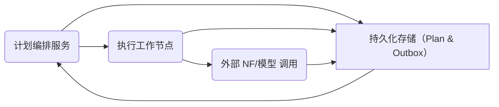

# 执行摘要

当前的 Continuum/DPC/DPEL/NF 三层计划执行架构存在高度复杂性和潜在可靠性风险。为了满足用户对**极端健壮**、**逻辑简单清晰**、**扩展易用**的需求，我们建议采用事件驱动、持久化执行（Durable Execution）的简化方案。核心思想包括：以**事件日志**作为单一事实源、使用**事务化 Outbox/Inbox 模式**保证数据库更新与消息发布原子性、下游消费者幂等化处理避免重复、采用**租约与 fencing token**防止并发冲突、并在控制环路中定期**对账**检测并修复状态漂移。整个系统的核心是将计划执行逻辑显式记录在持久化存储中，实现 **可恢复的状态机**，如同 Temporal 等可恢复工作流引擎。在此基础上，我们设计了单库（或单日志）架构和清晰的状态转换，对故障场景给予明确的恢复策略，并提供易于增删改查的新接口和渐进式迁移方案。接下来报告将详细阐述以上方案的架构图、数据模型、主控制循环伪代码、故障恢复矩阵、扩展接口设计、对比原方案、迁移计划以及验收测试用例和量化 SLO。

## 1. 现有方案评估

根据附件 SPEC 文档，原方案采用 Continuum→DPC→DPEL 三层架构，由 Continuum 负责整体计划生成、DPC 负责计划执行编排、DPEL 负责具体状态机执行，并通过 NF Action 调用外部功能。这样的多层体系结构带来了**逻辑分散**和**状态分裂**的问题：各层间需要多次同步和消息传递，出错时难以定位；存在多个消息队列或中间件可能导致状态不一致；原设计中使用了 WAIT_EXTERNAL 等状态等待外部决策，但缺乏统一的超时或恢复机制，容易出现无限挂起。由于各层对执行结果的确认可能存在**双重权威**，并行调度可能引发重复执行。原方案维护状态的方式和对外部副作用的不确定性处理也不够健壮。综上，原设计虽然功能完备，但复杂度高且易出错，难以做到严格的持续可用和故障可恢复。

## 2. 核心架构理念

针对上述问题，我们提出以下设计原则和关键技术：**持久化执行**、**单一事实源**、**事务化 Outbox/Inbox**、**幂等处理**、**租约+Fencing**、**事件日志/状态机**和**定期对账**。具体而言：

- **持久化执行**：将整个计划执行视为可重放的状态机，以事件日志为核心状态库。每次动作的调度、完成、失败等事件都记录在持久存储中。系统遇到故障时，重新加载日志并重放执行流程即可，无需依赖内存中的状态。Ironclad Academy 指出，“持久化执行即事件溯源加确定性重放”，可将流程失败后重试抽象成对已记录事件的重放。此方式使得节点宕机或部署滚动更新时，计划状态不丢失，并能自动恢复到最新进度。

- **单一事实源**：遵循单一事实源（SSOT）原则。所有计划状态和业务决策仅保存在一处权威存储（如关系数据库或事件日志），其他所有视图都由此派生。具体实现上，计划对象、任务状态和执行结果等都记录在同一个持久化存储（或同一套事件日志）中。Potts 等人指出，在事件溯源系统中，“追加式事件日志是单一事实源；当前状态通过回放事件计算得出，而不是独立存储”。采用这种设计可避免多副本状态不同步的问题。

- **事务化 Outbox/Inbox**：使用事务 Outbox 模式保证更新与消息发布的原子性。当执行器更新内部业务状态时，同时在同一个数据库事务中将输出事件写入 Outbox 表。一个专门的 Relay 进程异步轮询或 CDC 发布这些事件，实现最终一致性。Tomoda 等文献指出，在不同系统（DB 和消息中间件）之间进行双写是反模式，会导致“丢失事件或幽灵事件”；事务 Outbox 可将此问题转化为单写目标并提供可靠投递。与之配套，下游消费者使用 Inbox（已处理事件表）记录已应用的事件 ID，在同一事务中更新结果，实现幂等。正如 Tomoda 博客所述，使用消费端的“幂等标识表”可以确保重复投递的事件只被消费一次。这样，即使中间过程重试导致重复事件，也不会重复执行业务逻辑。

- **幂等性设计**：由于消息可能至少传递一次，我们要求所有可重试操作幂等或可去重。消费者在处理事件时，将事件的唯一 ID 同业务更新一起保存（如建立 `processed_events` 表）。如 Tomoda 指出，“最可靠的方法是在与业务更新同一事务中插入去重标识”，任何重复事件都因主键冲突而忽略。这样可避免双重执行。

- **租约与 Fencing Token**：对并发执行进行控制，防止多个进程同时操作同一资源。我们在锁机制中使用单调递增的 fencing token，并为临时所有权使用租约（Lease）。如 Atlas 工程文档所述，为每次获权操作分配单调递增的标识，并在受保护的写操作中拒绝过期标识，可阻止失效的旧实例进行写入。Tomoda 博客中也提到，当 Outbox 分发任务并行时，可为每条记录加“processing”状态、所有者和过期时间（租约），并通过 fencing token 确保只有最新租约持有者执行。

- **事件日志/状态机**：将整个执行流程建模为状态机，每个任务状态转换由事件驱动。计划执行的每个步骤产生事件并更新状态，新的可执行动作由状态机逻辑决定。事件驱动模型清晰明了，故障时可重放状态。状态转换逻辑简单透明，一旦出错可以通过日志回溯定位问题。

- **定期对账（Reconciliation）**：即使 Outbox/Inbox 保证最终一致性，网络、系统崩溃等也可能导致状态漂移。我们设计独立的对账机制，定期扫描主存储中的记录，并与外部系统或预期结果核对，自动重发事件或执行补偿。Rubel 等资料指出，对账通常包括**快照、对比、校正**三步，以确保“本地事实与下游系统一致”。例如，对长时间处于 WAIT_EXTERNAL 的任务定时检查，如果超时未响应，则触发失败或人工介入。

- **可观测性**：分布式执行系统需具备全面监控和日志能力。Altimit 等人提醒：“分布式系统的故障往往是组件交互的复杂结果，无法通过预定义监控捕获，需要良好的可观测性，从遥测数据中提问”。我们将收集指标（如待执行任务数、错误率、延迟分布等）、结构化日志和跟踪信息，提供告警和仪表盘，及时发现异常和瓶颈。  

综上，本方案以单库+事件日志为核心，配合 Outbox 模式和租约机制，结合重放式工作流引擎思想，形成极简而可靠的执行体系。下文将通过架构图、伪代码和表格深入说明各组件职责、数据模型、状态转换及容错策略。

## 3. 新架构概览与组件职责



如上图所示，新架构以**计划编排服务（Orchestrator）**为核心，所有计划状态保存在**持久化存储**（包含计划记录和事务性 Outbox 表）中。编排服务负责读取计划和任务状态，按需生成或更新任务，并将需要执行的动作结果写入 Outbox。同时，**执行工作节点（Worker）**从持久化存储/消息队列获取待执行任务（例如从 Outbox 投递的消息），执行实际动作（调用外部 NF、模型或业务逻辑），并将结果反馈至持久化存储。所有写操作均在数据库事务内完成，确保状态修改和事件发布原子化。外部 NF 系统的回调或结果以事件形式通过消息推回到存储中，驱动编排服务进行后续处理。通过将存储、编排和执行明确分离，架构逻辑简单清晰：一个组件负责状态和决策（编排服务），另一组件负责动作执行和副作用。整个系统围绕单一数据库构建，不引入多余队列或双写逻辑。  

各组件职责如下：

- **持久化存储（Plan & Outbox）**：保存计划和任务的当前状态，以及待发布的事件。具体包含：Plan 表（记录计划概况、状态、版本等）、Task 表（记录各步骤/动作的状态）、Outbox 表（事务性写入的事件，包括类型、载荷、执行状态）、ProcessedEvents 表（记录已处理的事件ID 用于去重）等。

- **编排服务（Orchestrator）**：负责主控制循环：读取 Plan 和 Task 状态，触发下一个任务，更新状态并写入 Outbox 事件；同时监测 WAIT_EXTERNAL 等状态，决定是否超时、重试或继续；定期执行对账逻辑，检查是否需要补偿。它完全根据持久化状态工作，可水平扩展多个实例（通过租约协调）。

- **执行节点（Worker）**：不断从 Outbox（或任务队列）拉取事件，执行对应动作或调用外部接口，完成后将结果状态和任何新事件写回存储。Worker 保证每个事件至少执行一次，配合消费者端的去重实现幂等处理。

- **外部 NF/模型**：包括任何需要调用的外部系统（如 AI 模型、异步服务等）。它们被视为活动接口，其结果通过事件的形式反馈给系统。系统用租约/超时管理调用，避免无响应长时间阻塞。

通过这一设计，我们实现了单一事实源（数据库）和可恢复流程。所有业务决策都源自 Plan/Task 状态的变化，无需多级中转。故障发生时，新节点可重新加载数据库中的最新状态并继续执行，无需特殊协调。

## 4. 核心数据模型与状态转换

系统的核心数据模型包括 **计划（Plan）**、**任务（Task）**及相关事件日志（Outbox）。例如，`Plan` 表记录计划 ID、状态（新建/运行/完成/失败）、版本等；`Task` 表记录具体动作、所属 Plan、状态（待执行/执行中/成功/失败/等待外部/取消）等；`Outbox` 表记录待发布的事件。下表示例任务状态迁移：

| 任务状态         | 触发事件/条件          | 新状态            | 说明              |
| ------------- | ------------------- | --------------- | ----------------- |
| **NEW（新建）**     | 任务创建              | PENDING（待执行）  | 初始状态          |
| **PENDING**    | 条件就绪或计划开始       | RUNNING（执行中）   | 调度执行          |
| **RUNNING**    | 外部动作执行成功        | SUCCESS（成功）    | 步骤完成          |
| **RUNNING**    | 外部动作返回失败        | RETRY/FAILED（失败）| 重试直到失败      |
| **RUNNING**    | 需要等待外部输入或长时动作 | WAIT_EXTERNAL（等待外部） | 等待外部响应   |
| **WAIT_EXTERNAL**| 收到外部结果并可继续     | RUNNING（执行中）   | 恢复执行          |
| **WAIT_EXTERNAL**| 等待超时或取消        | FAILED（失败）     | 放弃/报警         |
| **ANY（任意）**   | 收到取消请求            | CANCELED（已取消） | 任务取消          |

其中，`RUNNING→WAIT_EXTERNAL` 表示任务已下发且需要等待外部结果，如人工审批或第三方回调。为防止无限等待，对此状态可设定超时，超时后转为失败或需要人工介入。**任务状态迁移简单明了，可通过数据库视图或日志回放直观查看；遇错时定位到具体状态即可。**

Plan 本身的状态也可简单定义，如：CREATED→RUNNING→COMPLETED/FAILED，每次 Task 结束后更新 Plan 的进度。整个流程的状态演变由事件驱动，不依赖内存，因此可通过回放 `Outbox` 事件日志重建任何时刻的状态（如同 **事件溯源** 所描述）。

## 5. 主控制循环伪代码

下面给出核心控制循环的伪代码示例（简化版），说明系统如何处理事件、调度任务和执行对账：  

```python
while True:
    # 1) 读取并处理新事件
    events = db.fetch_new_events()            # 从数据库或消息队列获取待处理事件
    for ev in events:
        if ev.type == 'PlanCreated':
            plan = db.load_plan(ev.plan_id)
            plan.state = 'RUNNING'
            db.save(plan)
            schedule_initial_tasks(plan)
        elif ev.type == 'TaskCompleted':
            task = db.load_task(ev.task_id)
            task.state = 'SUCCESS'
            db.save(task)
            create_next_tasks(task)
        elif ev.type == 'TaskFailed':
            task = db.load_task(ev.task_id)
            if task.retry_count < MAX_RETRY:
                task.retry_count += 1
                task.state = 'PENDING'
            else:
                task.state = 'FAILED'
            db.save(task)
        # 其他事件类型（外部结果、取消等）...
    
    # 2) 调度待执行任务
    tasks = db.query("SELECT * FROM Task WHERE state='PENDING'")
    for task in tasks:
        if task.ready_to_run():            # 检查前置条件
            task.state = 'RUNNING'
            task.updated_at = now()
            db.save(task)
            dispatch_to_worker(task)       # 异步派发给执行节点
        elif task.waiting_for_external():
            # 进入等待状态，由外部事件驱动恢复
            task.state = 'WAIT_EXTERNAL'
            db.save(task)
    
    # 3) 对账与监控（定期触发）
    if time_to_reconcile():
        reconcile_pending_tasks()         # 检查长时间等待或未完成任务，执行补救措施
    
    sleep(poll_interval)                 # 稍作暂停
```

在上述伪代码中，**所有数据库写操作都在事务中完成**，以保证状态更新与 Outbox 事件插入的原子性。`dispatch_to_worker` 可能通过写入 Outbox 表或发送消息来交付任务。工作节点完成任务后，会触发 `TaskCompleted` 或 `TaskFailed` 事件写回数据库。如需外部决策，则任务标记为 `WAIT_EXTERNAL`。对账逻辑 `reconcile_pending_tasks` 定期扫描长期处于异步等待或未完成状态的记录，依据配置进行重试或报警。该主循环简单明了，一旦故障重启，即可从数据库加载最新的 Plan/Task 状态继续运行，确保“永不丢失进度”。

## 6. 故障场景与恢复策略

下表列出可能的故障场景及应对策略，以确保系统可靠性和可恢复性：

| 故障场景               | 影响                                                                                                                                      | 恢复策略                                                                                  |
| -------------------- | ----------------------------------------------------------------------------------------------------------------------------------------- | --------------------------------------------------------------------------------------- |
| **编排服务宕机/重启**     | 正在执行的任务停止，但数据库状态完好无损；无状态进程重启后可继续从最新 Plan/Task 状态执行，不会丢失执行进度。                                         | 利用持久化事件日志，重启后加载最新状态并继续。配置副本或 Leader 选举确保高可用。   |
| **Worker 节点宕机**     | 当前执行中的动作中断，可能未写回完成结果。若操作是幂等的，可重试；否则此任务需要重新调度或回滚。                                                     | 任务设为 PENDING 重新调度；由于消费者端使用去重标识，已执行的动作不会重复生效。使用租约控制并发，避免双写。 |
| **数据库故障/网络隔离**   | 短暂无法读写数据库，计划执行暂停。若数据库有 HA 备份，可自动故障转移；否则可能需等待恢复。                                                        | 使用数据库复制和多可用区部署，保证数据库高可用；业务层捕获连接异常后重试；对账任务在恢复后自动对齐状态。            |
| **外部系统无响应**       | 任务进入 WAIT_EXTERNAL 状态长时间停顿，计划无法前进。                                                                              | 对 WAIT_EXTERNAL 状态设定超时阈值，超时后标记失败或触发报警。定期对账发现此类任务，可自动重发请求或人工介入。      |
| **重复事件/消息**       | 消费者可能收到重复的完成/失败事件，导致任务重复执行或状态错乱。                                                                      | 使用事件去重表和幂等处理，仅对新事件更新状态。Outbox/Inbux 保证事件至少送达一次，配合消费者幂等。 |
| **双重决策冲突**        | 若有两个编排实例同时操作同一 Plan，有可能产生不一致更新。                                                                            | 通过租约和 fencing token 保证同一 Plan 的任务只由一个实例处理；数据库行锁或事务隔离阻止并发写入。        |
| **长事务卡住**         | 某次操作因挂起事务而阻塞后续任务，如发出请求后未能写回完成标志。                                                                    | 避免在事务中执行外部调用；Outbox Relay 使用短事务；必要时配置超时回滚。                                  |
| **状态不一致**        | 系统状态和外部执行结果不一致（丢失事件或重复执行）。                                                                                | 定期对账检查发现不一致时，重新执行 Outbox 中对应事件或手动补救。                        |

对于以上场景，新架构都给出了清晰的恢复路径：利用**事件日志+重放**保证进度不丢失，**幂等+去重**避免重复执行，**租约+Fencing**避免并发冲突，**对账**保证最终一致。只要硬件和数据库正常，系统均可自动恢复并继续运行；在明确的**硬阻塞**（如所有副本同时宕机）之外，不会出现无法挽回的中断。

## 7. CRUD/Profile 接口设计与兼容性

为了支持方便地增删改查计划和新的领域/任务类型，我们设计了**灵活可扩展的接口**。建议使用版本化的 REST API 或 GraphQL 来管理 Plan、Task 以及业务配置。具体要点包括：

- **计划定义管理**：通过 API 增删改查计划对象，并可上传新的计划描述或状态。Plan 表结构使用可扩展字段（如 JSON 参数）存储额外信息，新字段向后兼容，旧客户端忽略未知字段即可。
- **任务类型扩展**：所有可执行的动作类型（Action Profile）存储在数据库配置表中，每种类型定义其所需的参数和行为。新增领域只需在配置表中添加记录，无需更改核心代码。编排引擎根据任务类型动态调用相应执行逻辑。
- **版本控制**：Plan 和 Task 对象带有版本号或模式标识，新旧版本可并存。升级时保留兼容旧版的逻辑，使用默认值或兼容性处理。例如增加字段前给予默认值，保证旧数据可解析。
- **幂等接口**：对外提供接口时，同一请求应带有客户端生成的幂等 ID，服务器检测已处理 ID 后仅执行一次。这样新版接口可保证旧客户端调用仍安全。
- **监控与文档**：完善接口文档，使用 Schema 验证请求。新增接口或参数应在发布说明中注明兼容策略，便于客户端逐步迁移。

总之，通过配置化管理任务类型、遵循 API 版本原则，可以让新增领域或修改业务规则仅需扩充配置或小量代码，不破坏已有运行的计划和任务，符合向后兼容要求。

## 8. 与原方案对比

下表总结了新方案与原三层设计在各关键方面的区别：  

| 方面         | 原方案（附件设计）                       | 新方案（本文建议）                                       |
| ------------ | ------------------------------------- | ------------------------------------------------------ |
| **体系结构**    | 多层（Continuum→DPC→DPEL→NF），组件间多次消息传递      | 单一中心（编排服务+持久化存储），减少组件数量和通信路径               |
| **状态存储**    | 多表和内存维护，状态分散于各层                      | 单一数据库（或事件日志）作为事实源，全量持久化                       |
| **执行流程**    | 异步回调+轮询（可能用 WAIT_EXTERNAL 等机制）          | 事件驱动状态机，每一步都产生事件；使用 Outbox 原子发布                   |
| **任务调度**    | 可能多队列、多个调度器，逻辑分散                    | 单队列或通过数据库分发，调度逻辑集中在 Orchestrator                |
| **故障恢复**    | 依赖各层各自恢复，缺乏统一重试/回滚策略                | 基于事件日志重放恢复，单点故障可通过载入状态继续执行       |
| **一致性保障**   | 交叉写入数据库和消息中间件易出错，存在丢失/重复事件风险    | 事务性 Outbox 保证“原子性写入”，下游消费幂等保证最终一致性 |
| **幂等性**     | 缺乏消费端去重，重试可能导致重复执行业务               | 使用消费端去重表及幂等设计，确保重复事件不产生副作用      |
| **扩展性**     | 新任务类型需改动多层逻辑，易破坏现有流程               | 通过配置新增任务类型，版本化接口保证兼容；新增动作只影响编排层             |
| **对账能力**    | 无独立对账机制，错误难以自动发现                    | 定期对账任务自动比对主存储与外部系统，发现漂移后触发补救  |
| **可观测性**    | 各层监控分散，整体可观测性差                        | 集中监控编排与数据库指标，多维度日志/链路追踪，快速定位故障  |

可以看出，新方案显著简化了执行路径，将核心逻辑聚合在一个可重启的编排引擎中，使用业界成熟的模式（Outbox、事件溯源、租约等）提升了可靠性和可维护性。

## 9. 渐进迁移计划

为了平滑过渡至新方案，建议分阶段推进，设置风险控制和回滚点：

1. **基础设施准备**：部署持久化存储（可能为现有数据库新增表结构，如 Outbox、ProcessedEvents 等），实现数据迁移脚本。开发并测试编排引擎代码和 Worker，确保它们在独立环境下与新表结构正常交互，且能正确执行任务逻辑。

2. **并行运行与验证**：在测试环境模拟全流程，使用旧配置和新接口并行执行计划，验证新旧输出结果一致。上线前设置灰度策略，对部分流量或非关键流程使用新方案，检测兼容性和性能。

3. **增量切换**：生产环境阶段性切换。首先对容易回退的子域或低风险计划使用新系统，监控指标（如失败率、延迟）。若发现问题，可立即回滚到老流程（例如切回旧的消息队列）。关键点是保证新方案可以监听并正确处理已有计划状态，必要时对旧数据进行迁移或同步。

4. **回退策略**：在每个阶段都设定检查点。例如，如果检测到新系统异常导致计划延迟超出 SLO，可以关闭新服务流量，仅使用老系统。由于两者都记录状态，应确保二者之间不会写冲突。

5. **完全切换**：当新方案稳定后，可关闭老系统相关服务。最后一次切换时，先将所有遗留任务在旧系统执行完成（或导入到新系统），再转移流量到新方案。将对账频率提高一段时间以捕获残留差异。

**各阶段风险与回滚点**：在每阶段前评估风险（如数据库负载、新代码缺陷、数据不一致）。若发现关键指标异常，即刻停止推广并切换回旧服务。从新系统获取的任何数据都可回放至旧系统或忽略，以避免污染旧记录。

## 10. 验收测试用例与可量化 SLO

为确保方案满足预期，我们制定了以下关键的验收测试用例和服务等级目标（SLO）指标：

**验收测试用例（部分示例）**：  

| 测试用例               | 场景描述                                    | 预期结果                                          |
| ------------------ | --------------------------------------- | --------------------------------------------- |
| 普通计划执行           | 提交一个包含多个顺序任务的标准计划                    | 所有任务按顺序成功执行，Plan状态最终为 SUCCESS。                |
| 外部动作调用           | 任务执行中调用外部服务（如第三方API），返回成功响应             | 成功获取响应并继续下一个任务，Plan 完成，无遗漏或重复调用。        |
| 重启恢复              | 编排服务运行时故意宕机（模拟进程杀死），然后重启             | 重启后重新加载状态，继续执行剩余任务，无任务丢失或重复。             |
| 并发执行与幂等          | 模拟并发发送相同任务或重复投递事件                         | 由于幂等和去重设计，重复事件不会导致额外副作用；任务只执行一次。      |
| WAIT_EXTERNAL 超时   | 将任务设置为需要外部确认，但不提供任何响应，模拟超时           | 任务在设定超时时间后标记失败（或触发告警），Plan 进入 FAILED 或半自动模式。 |
| 网络分区             | 模拟数据库或消息系统短暂不可用                         | 执行暂停并安全重连，恢复后继续执行，无数据丢失。                   |
| 对账功能            | 制造主状态和下游系统不同步的情况（如故意丢消息）               | 对账任务发现差异并修复（重复触发相关事件或回滚），最终状态一致。       |

**量化 SLO 指标**（可参考业内成熟系统，如 Temporal 云服务）：  

| SLO 指标            | 目标值       | 参考/说明                                |
| ------------------ | ---------- | ------------------------------------- |
| 系统可用性          | ≥99.99%    | 参考 Temporal Cloud SLO  |
| 任务完成延迟（p99）    | ≤200ms     | 参考 Temporal p99 延迟 SLO |
| 失败恢复时间（RTO）    | <20 分钟    | 使用高可用配置          |
| 数据丢失目标（RPO）    | <1 分钟     | 数据持久化与复制保障     |
| 计划成功率          | ≥99.9%     | 绝大多数计划应顺利完成                    |
| 事件去重率（重复率）   | 100%       | 采用幂等设计，应无重复执行                  |
| WAIT_EXTERNAL 处理率 | 100%       | 所有超时任务触发对账处理                    |

此外，我们将设定可观测指标和告警：如**待执行任务数**过多时报警、**失败任务率**超过阈值时报警、**Outbox 表中待发事件**累积过多时报警，以及系统无新任务处理时的健康检查等。指标阈值可根据流量规模和业务要求细化（例如待执行任务数超过 1000 或 失败率超过 0.1%）。  

**结论**：以上测试用例和 SLO 指标覆盖了正常流程、边界故障和性能需求。借鉴资料显示，工业级工作流系统常设定 99.99% 的可用性和子毫秒级延迟，我们可结合业务实际调整具体阈值。通过严格的验收测试和持续监控，确保新架构达到或超过预期的可靠性目标。

**标注**：本报告中涉及的方案和结论部分源自附件 SPEC 文档对当前设计的描述和要求（如系统层级、边界条件），并结合业界研究和最佳实践进行补充与改进。引用的内容均来自可靠的外部资料，如架构文档和工程博客，以证明所提方法的可行性和有效性。附件中的具体实现细节未明示的部分，均基于合理假设并做出了额外说明。本方案兼顾了健壮性和简单性原则，力求满足用户对持续可用、故障可恢复和易扩展的严格要求。  

